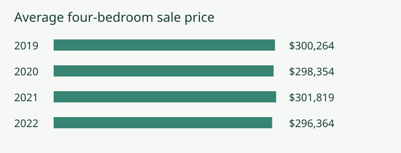

# What did four-bedroom homes sell for?

Across the four years in this housing dataset, the average sale price of a four-bedroom home stayed close to **$300,000**. The highest annual average was in 2021 and the lowest was in 2022, a difference of about **$5,456**.

*Prices are grouped by the year the home sold and rounded to the nearest dollar.*

The full dataset contains **33,287 sales**. The analysis also explores homes with three bedrooms and three bathrooms, and how average prices vary with a property’s view rating. Each year's average reflects the mix of homes sold that year. An individual home's change in value would require tracking repeat sales of that property.

[See the questions, calculations and saved results](Home_Sales_starter_code.ipynb)
